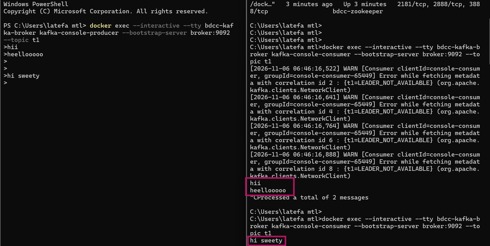
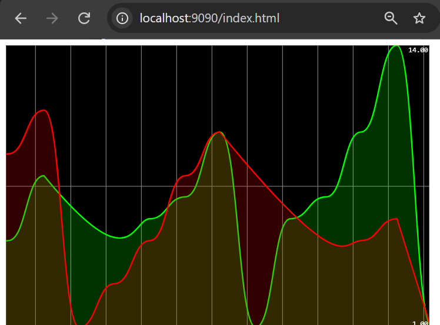
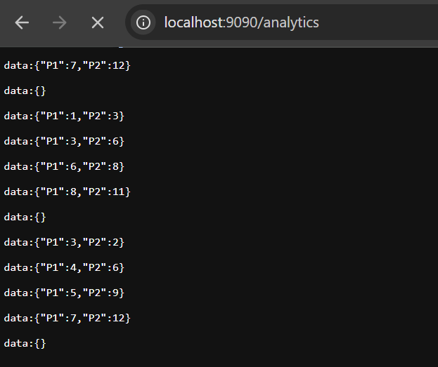

# Kafka et Spring Cloud Stream : traitement temps réel d'événements

## Présentation

L'application simule des visites de pages web. Chaque visite est représentée par un événement `PageEvent`, publié dans un topic Kafka, traité en continu, puis visualisé en temps réel dans une page web.

## Objectifs

- Démarrer un broker Kafka et Zookeeper avec Docker Compose
- Tester les échanges avec Kafka Console Producer et Kafka Console Consumer
- Publier des messages dans un topic depuis un contrôleur REST (StreamBridge)
- Consommer des messages avec un Consumer Spring Cloud Stream
- Produire un flux continu de messages avec un Supplier
- Réaliser des analyses en temps réel avec Kafka Streams (filtrage, regroupement, fenêtrage, comptage)
- Visualiser le résultat dans une page web via Server-Sent Events

## Technologies

| Composant | Technologie |
|---|---|
| Langage | Java 21 |
| Framework | Spring Boot, Spring Cloud Stream |
| Broker | Apache Kafka, Zookeeper |
| Traitement de flux | Kafka Streams |
| Conteneurisation | Docker, Docker Compose |
| Frontend | HTML, JavaScript, Smoothie.js |
| Build | Maven |

## Modèle de données

Un `PageEvent` est défini par les attributs suivants :

| Attribut | Type | Description |
|---|---|---|
| name | String | Nom de la page visitée (P1 ou P2) |
| user | String | Utilisateur ayant visité la page (U1 ou U2) |
| date | Date | Date de la visite |
| duration | long | Durée de la visite en millisecondes |

## Architecture

```
                         +-----------------------+
   GET /publish  ------> |  PageEventController  |
   (navigateur)          |    (StreamBridge)     |
                         +-----------+-----------+
                                     |
                                     v
                              +-------------+
                              |  Topic T2   |
                              +------+------+
                                     |
                                     v
                         +-----------------------+
                         |  pageEventConsumer    |
                         |  (affichage console)  |
                         +-----------------------+


   +----------------------+       +-------------+       +----------------------+
   |  pageEventSupplier   | ----> |  Topic T3   | ----> |    kStreamFunction   |
   |  (1 message / 200ms) |       |  (flux brut)|       |  filter, map,        |
   +----------------------+       +-------------+       |  groupByKey,         |
                                                        |  windowedBy (5 s),   |
                                                        |  count               |
                                                        +----------+-----------+
                                                                   |
                                          +------------------------+----------------+
                                          |                                         |
                                          v                                         v
                                   +-------------+                          +---------------+
                                   |  Topic T4   |                          |  State Store  |
                                   | (résultats) |                          |  count-store  |
                                   +-------------+                          +-------+-------+
                                                                                    |
                                                                  InteractiveQueryService
                                                                                    |
                                                                                    v
                                                                  +-----------------------------+
                                                                  | GET /analytics (SSE, 1 s)   |
                                                                  +--------------+--------------+
                                                                                 |
                                                                                 v
                                                                  +-----------------------------+
                                                                  | index.html (Smoothie.js)    |
                                                                  | courbes P1 et P2            |
                                                                  +-----------------------------+
```

### Description des flux

1. Le contrôleur REST publie un `PageEvent` dans le topic T2. Le consumer Spring l'affiche dans la console.
2. Le supplier génère un `PageEvent` aléatoire toutes les 200 ms et l'envoie dans le topic T3, ce qui simule un capteur.
3. La fonction Kafka Streams lit T3, regroupe les visites par page sur une fenêtre glissante de 5 secondes, compte les visites et publie le résultat dans le topic T4.
4. Le résultat du comptage est matérialisé dans un store local nommé `count-store`.
5. Le endpoint `/analytics` interroge ce store chaque seconde et pousse les valeurs vers le navigateur sous forme de flux d'événements (Server-Sent Events).
6. La page `index.html` affiche l'évolution du nombre de visites de P1 et P2 en temps réel.

## Structure du projet

```
.
|-- assets/
|   |-- page-analytics.png
|   |-- page-web.png
|   `-- test-consumer-producer.png
|-- src/main/
|   |-- java/.../kafkaspringcloud/
|   |   |-- controllers/PageEventController.java
|   |   |-- events/PageEvent.java
|   |   |-- handlers/PageEventHandler.java
|   |   `-- KafkaSpringCloudApplication.java
|   `-- resources/
|       |-- static/index.html
|       `-- application.properties
|-- compose.yml
`-- pom.xml
```

## Prérequis

- JDK 21
- Maven
- Docker et Docker Compose

## Démarrage

### 1. Lancer Kafka et Zookeeper

```bash
docker compose up -d
```

### 2. Tester avec la console Kafka

Consumer sur le topic T1 :

```bash
docker exec -it bdcc-kafka-broker kafka-console-consumer \
  --bootstrap-server localhost:9092 --topic T1
```

Producer sur le topic T1 :

```bash
docker exec -it bdcc-kafka-broker kafka-console-producer \
  --bootstrap-server localhost:9092 --topic T1
```

Chaque message saisi dans le producer apparaît dans le consumer. L'option `--from-beginning` permet de relire tous les messages du topic.



### 3. Lancer l'application

```bash
./mvnw spring-boot:run
```

## Utilisation

### Publication d'un événement

```
http://localhost:9090/publish?name=P1&topic=T2
```

L'événement est publié dans le topic demandé et retourné au format JSON.



### Consultation des analyses

```
http://localhost:9090/analytics
```

Ce endpoint retourne un flux d'événements contenant, chaque seconde, le nombre de visites de chaque page sur les 5 dernières secondes.

### Visualisation temps réel

```
http://localhost:9090/index.html
```

La page affiche deux courbes : une pour la page P1 et une pour la page P2. Les premiers résultats apparaissent après un délai initial d'environ 30 secondes, correspondant à l'intervalle de commit par défaut de Kafka Streams.



### Lecture du résultat dans le topic T4

```bash
docker exec -it bdcc-kafka-broker kafka-console-consumer \
  --bootstrap-server localhost:9092 --topic T4 \
  --property print.key=true --property print.value=true \
  --property key.deserializer=org.apache.kafka.common.serialization.StringDeserializer \
  --property value.deserializer=org.apache.kafka.common.serialization.LongDeserializer
```

## Configuration

Extrait de `application.properties` :

```properties
spring.cloud.function.definition=pageEventConsumer;pageEventSupplier;kStreamFunction

spring.cloud.stream.bindings.pageEventConsumer-in-0.destination=T2

spring.cloud.stream.bindings.pageEventSupplier-out-0.destination=T3
spring.cloud.stream.poller.fixed-delay=200

spring.cloud.stream.bindings.kStreamFunction-in-0.destination=T3
spring.cloud.stream.bindings.kStreamFunction-out-0.destination=T4
spring.cloud.stream.kafka.streams.binder.configuration.commit.interval.ms=1000
```

## Composants principaux

| Classe | Rôle |
|---|---|
| `PageEvent` | Record représentant une visite de page |
| `PageEventController` | Expose `/publish` (StreamBridge) et `/analytics` (SSE, lecture du store) |
| `PageEventHandler` | Déclare les beans `pageEventConsumer`, `pageEventSupplier` et `kStreamFunction` |


